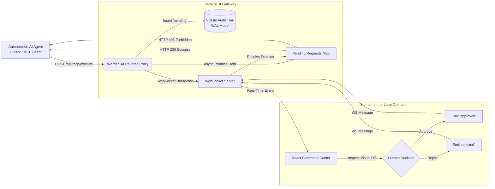

# Warden-AI: Strict-Control AI Harness & Security Gateway

[](https://opensource.org/licenses/MIT)
[](https://nodejs.org/)
[](https://www.typescriptlang.org/)
[](https://react.dev/)
[](https://tailwindcss.com/)
[](https://www.docker.com/)

> **Zero-Trust Reverse Proxy & Real-Time Human-in-the-Loop Gateway for Autonomous AI Coding Agents and Model Context Protocol (MCP) Tool Calls.**

---

## 🛡️ Why Warden-AI?

Autonomous AI coding agents (such as Cursor, Claude Desktop, and CLI agents) are increasingly equipped with broad write permissions to local filesystems and shell execution environments. When prompt injection attacks, supply-chain vulnerabilities, or agent hallucinations occur, an agent can silently modify critical code, alter `.env` secrets, or run destructive terminal commands.

**Warden-AI** acts as an air-gapped security harness between autonomous AI agents and your local environment. It intercepts tool execution requests, freezes the agent's HTTP connection in memory via the **Async Hold Pattern**, and forces all filesystem mutations and terminal commands through a human-in-the-loop React approval dashboard before any code touches your disk.

---

## 🏗️ Architecture



---

## ✨ Key Features

- **The Async Hold Pattern:** Traps incoming agent HTTP tool calls inside unresolved JavaScript promises. Zero polling overhead, sub-millisecond dispatch, and fully transparent to MCP clients.
- **Side-by-Side Payload Diff Inspector:** Embedded visual diff engine (`react-diff-viewer-continued`) highlights proposed additions and deletions before execution.
- **Real-Time Control Plane:** Bidirectional WebSocket stream instantly notifies the operator and unblocks waiting CLI processes upon human approval.
- **Immutable SQLite Audit Trail:** Every single tool call is cryptographically timestamped and persisted locally in SQLite (`audit_logs`) with status, agent name, and exact payload parameters.
- **Zero Cloud Dependencies:** 100% local execution. No telemetry, no external database dependencies, and no Docker requirement.
- **Newcomer-Proof DevEx & Preflight Healthcheck:** Built-in bootloader verifies Git availability, workspace write permissions, Docker daemon health, and validates environment variables via Zod before booting.

---

## 📁 Repository Structure

```text
Warden-AI/
├── .env.example                # Canonical environment variable template
├── docker-compose.yml          # One-command orchestration for all services
├── package.json                # Root orchestration & bootstrap scripts
├── backend/
│   ├── Dockerfile              # Multi-stage Node 20 Alpine build
│   ├── .dockerignore
│   ├── src/
│   │   ├── index.ts           # Express & WebSocket server entrypoint
│   │   ├── cli/
│   │   │   └── healthcheck.ts # Preflight bootloader verification suite
│   │   ├── config/
│   │   │   └── env.ts         # Zod environment schema & path validation
│   │   ├── db/
│   │   │   └── client.ts      # SQLite audit trail initialization & queries
│   │   ├── proxy/
│   │   │   └── interceptor.ts # Async request holding logic & MCP route
│   │   ├── security/
│   │   │   └── honeypot.ts    # Cryptographic decoy honeypots & IDS quarantine
│   │   ├── utils/
│   │   │   └── model-loader.ts# Graceful model loader with terminal feedback
│   │   └── ws/
│   │       └── socket.ts      # WebSocket server & approval dispatcher
│   ├── scripts/
│   │   ├── test-agent.ts      # Mock autonomous AI agent simulator
│   │   └── test-honeypot-breach.ts # IDS intrusion & session lockout test
│   ├── package.json
│   └── tsconfig.json
├── frontend/
│   ├── Dockerfile              # Multi-stage Vite build → Nginx serving
│   ├── .dockerignore
│   ├── nginx.conf              # Nginx reverse proxy for API & WebSocket
│   ├── src/
│   │   ├── App.tsx            # Main Zero-Trust Command Center UI
│   │   ├── components/
│   │   │   ├── RequestCard.tsx# Intercepted action card & decision gates
│   │   │   └── DiffViewer.tsx # Visual payload & code diff inspector
│   │   └── hooks/
│   │       └── useWebSocket.ts# Real-time WebSocket state management
│   ├── package.json
│   ├── vite.config.ts
│   ├── tailwind.config.js
│   └── tsconfig.json
└── README.md
```

---

## 🚀 Quick Start Guide

### Prerequisites
- **Node.js**: v18.0.0 or newer
- **Git**: Installed and accessible in system `$PATH`
- **npm** or **pnpm** / **yarn**

---

### Step 1: Clone the Repository
```bash
git clone https://github.com/hariom123-dev/Warden-AI.git
cd Warden-AI
```

Optional: Copy the environment configuration template:
```bash
cp .env.example .env
```
*(If omitted, sane local defaults will be applied automatically.)*

---

### Step 2: Start the Backend Gateway (Terminal 1)
```bash
cd backend
npm install
npm run bootstrap   # Runs preflight healthcheck (Git, Docker, write access, env)
npm run dev
```
> Server will listen on **`http://localhost:3001`** and mount the WebSocket control stream. Note: `npm run dev` and `npm start` automatically run the healthcheck preflight via `predev`/`prestart`.

---

### Step 3: Start the React Security Dashboard (Terminal 2)
```bash
cd frontend
npm install
npm run dev
```
> Open your browser to **`http://localhost:5173`**. The dashboard will display **"System Secure: No pending AI actions"**.

---

### Step 4: Run the Mock Autonomous Agent (Terminal 3)
```bash
cd backend
npm run test:agent
```

### Observation:
1. **Terminal 3 pauses and holds:** The agent prints `STATUS: WAITING FOR HUMAN OPERATOR APPROVAL` with an active timer.
2. **Dashboard lights up:** The intercepted tool call pops up in the React dashboard with the file path (`src/core/auth.ts`) and proposed code diff.
3. **Approve or Reject:** Click **"Approve Action"** to unblock the agent with HTTP 200, or **"Reject Action"** to abort the operation with HTTP 403.

---

## 🐳 Docker Deployment (One-Command Setup)

### Prerequisites
- [Docker](https://docs.docker.com/get-docker/) v20+ and [Docker Compose](https://docs.docker.com/compose/install/) v2+

### Launch Everything

```bash
git clone https://github.com/hariom123-dev/Warden-AI.git
cd Warden-AI
docker compose up --build
```

| Service | URL |
|---------|-----|
| **Security Dashboard** | [http://localhost:5173](http://localhost:5173) |
| **Backend API / WebSocket** | [http://localhost:3001](http://localhost:3001) |

### Stop & Cleanup

```bash
# Stop all services
docker compose down

# Stop and remove persisted SQLite data
docker compose down -v
```

> **Note:** The SQLite audit trail is persisted in a Docker volume (`warden-data`). Use `docker compose down -v` to remove it when starting fresh.

---

## 🔒 Security & Audit Schema

All requests are logged immutably to `audit.db` using Write-Ahead Logging (WAL):

```sql
CREATE TABLE IF NOT EXISTS audit_logs (
    id TEXT PRIMARY KEY,
    timestamp DATETIME DEFAULT CURRENT_TIMESTAMP,
    agent_name TEXT,
    action_type TEXT,
    payload TEXT,
    status TEXT -- 'pending', 'approved', 'rejected'
);
```

---

## 🤝 Contributing

Contributions, issues, and feature requests are welcome! Feel free to check out the [issues page](https://github.com/hariom123-dev/Warden-AI/issues).

---

## 📄 License

This project is open-source software licensed under the [MIT License](LICENSE).
